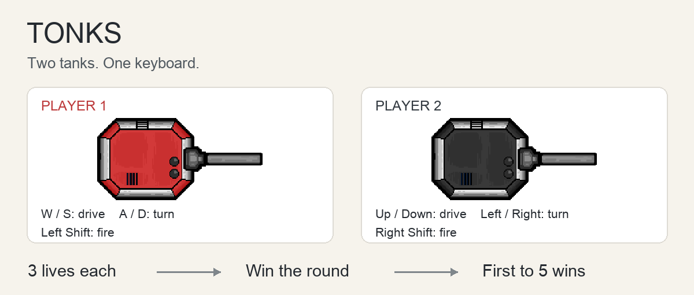

# TONKS

TONKS is a local two-player tank game built in Unity. Both players share a keyboard and an arena, driving, turning, and firing at each other. Each tank has three lives, and the first player to win five rounds wins the match.



*Controls and round structure, illustrated with the game's tank sprites.*

## Motivation

A small arena game gives us a way to bring several game-development systems together without a long set of rules. Movement, projectiles, collisions, health, sound, and scoring all need to work together for a round to make sense.

TONKS explores that through a simple contest between two people. Turning the tank also changes its aim, and bullets can bounce off walls, so positioning matters as much as firing first.

## Playing

Choose **Start** from the menu to enter the arena. Drive forward or backward, rotate to aim, and fire at the other tank. Shots have a half-second cooldown.

| Action | Player 1 | Player 2 |
| --- | --- | --- |
| Drive forward / backward | W / S | Up / Down arrows |
| Turn left / right | A / D | Left / Right arrows |
| Fire | Left Shift | Right Shift |

A hit removes one life. When a tank loses all three lives, the other player earns a round and the arena reloads. After five round wins, the winner screen offers another match or a return to the menu. The sound button toggles the background music; Escape quits a built game.

Movement bindings are in [InputManager.asset](ProjectSettings/InputManager.asset). The firing keys are assigned to each tank in [SampleScene](Assets/Scenes/SampleScene.unity).

## How it works

The game uses C# scripts, Unity's 2D physics, and a shared camera.

- [PlayerController](Assets/Scripts/PlayerController.cs) reads each player's input, moves and rotates the tank, fires projectiles, and handles damage and destruction.
- [Bullet](Assets/Scripts/Bullet.cs) keeps projectiles moving at a fixed speed, counts collisions, and triggers hit and bounce effects. The bullet prefab sets a limit of three collisions before destruction.
- [MSManager](Assets/Scripts/MSManager.cs) creates screen-edge colliders, records round scores, and decides whether to begin another round or end the match. Scores carry between rounds through `PlayerPrefs`.
- [SoundManagerScript](Assets/Scripts/SoundManagerScript.cs) plays temporary sound effects and coordinates the delay before a scene change. [BackgroundMusicScript](Assets/Scripts/BackgroundMusicScript.cs) manages the music toggle.
- [CameraController](Assets/Scripts/CameraController.cs) sizes the camera to the arena, while the menu and end-screen scripts handle the match's entry and exit points.

The scenes form a short loop: **MenuScreen → SampleScene → EndScreen**. `SampleScene` is the arena; it reloads between rounds until one player reaches five wins.

## Opening the project

The project records **Unity 2022.3.8f1** in [ProjectVersion.txt](ProjectSettings/ProjectVersion.txt).

```sh
git clone https://github.com/TheDeafOne/TONKS.git
```

1. Install Unity 2022.3.8f1 through Unity Hub.
2. In Unity Hub, choose **Add project from disk** and select the cloned `TONKS` folder.
3. Let Unity import the assets and restore the packages listed in `Packages/`.
4. Open `Assets/Scenes/MenuScreen.unity` and press **Play**.

To create an executable, install the Unity build-support module for your target platform. In **File → Build Settings**, keep the enabled scenes in their recorded order: `MenuScreen`, `SampleScene`, and `EndScreen`. Choose the target platform and build.

## Project files

- [Scenes](Assets/Scenes) — menu, arena, and winner screen
- [Scripts](Assets/Scripts) — gameplay, match state, camera, and sound
- [Prefabs](Assets/Prefabs) — tanks, bullets, effects, and interface elements
- [Sprites](Assets/Sprites) — tank and arena art
- [Package versions](Packages/manifest.json)
